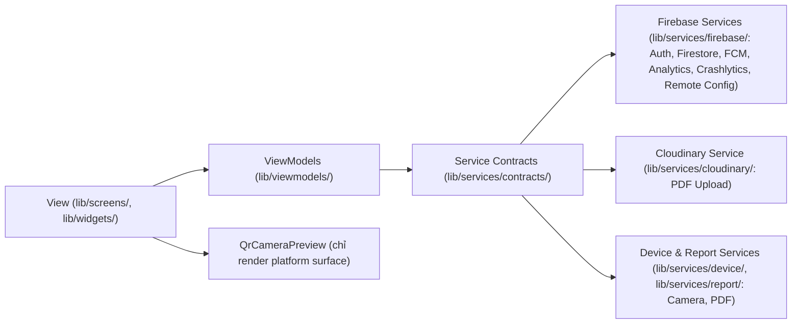
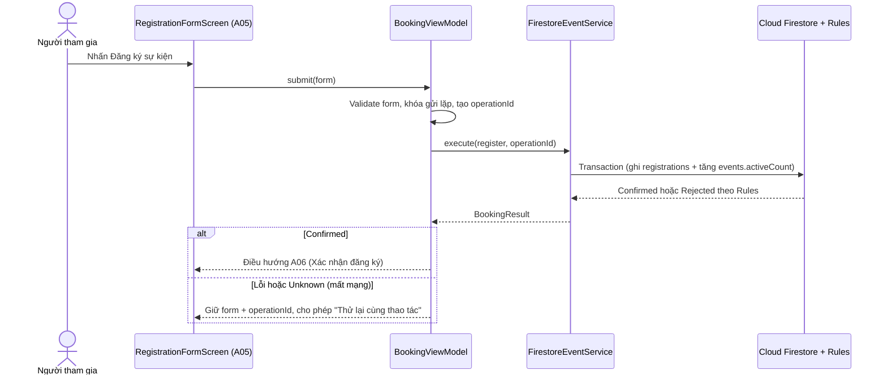

# Kiến trúc EventHub — Lab 3

Cập nhật 12/11/2026. Ứng dụng **EventHub** là app mobile Flutter Android xây dựng theo kiến trúc **MVVM với Riverpod**. Phụ thuộc luôn đi một chiều từ trên xuống (`Screens/Widgets → ViewModels → Service Contracts → Services/Firebase/Cloudinary`).

## 1. Sơ đồ phân tầng (Layer Diagram)

## 2. Cấu trúc thư mục `lib/` và ranh giới lớp

| Thư mục | Trách nhiệm |
|---|---|
| `lib/app/` | Composition root (`ProviderScope`), `GoRouter`, bootstrap Firebase và vòng đời ứng dụng; không được import ngược từ ViewModel |
| `lib/models/` | Kiểu dữ liệu thuần (`Event`, `Registration`, `AppNotification`, `UserProfile`, trạng thái lỗi/tải); không gọi SDK |
| `lib/screens/` | Giao diện các màn `A01a–d`, `A02–A12`, `L3-01`, `L3-02`; chỉ đọc state từ ViewModel/Provider và chuyển tiếp sự kiện người dùng, tuyệt đối không gọi `FirebaseAuth`, `FirebaseFirestore` hay `http` |
| `lib/viewmodels/` | Điều phối trạng thái (`loading/empty/error/data`), validation form, logic lọc/lịch, khóa submit lặp và gọi Analytics qua contract |
| `lib/services/contracts/` | Interface trừu tượng (`AuthService`, `EventService`, `NotificationService`, `ReportService`, `ReportStorageService`, `QrCamera`, `CloudServices`) để inject fake trong unit/widget test |
| `lib/services/firebase/` | Triển khai thực tế Firebase Auth, Cloud Firestore (transaction + QR hash), FCM, Analytics, Crashlytics và Remote Config |
| `lib/services/cloudinary/` | Upload file PDF lịch tham gia qua Cloudinary unsigned preset |
| `lib/services/device/` | Adapter phần cứng (`QrCameraService` bọc `mobile_scanner`, được inject qua `qr_camera_provider.dart`) |
| `lib/services/report/` | Tạo file PDF tiếng Việt cục bộ từ danh sách đăng ký đang xem |
| `lib/services/*_providers.dart` | Riverpod providers cung cấp service qua contract; không import ViewModel hoặc UI |
| `lib/theme/` | Token giao diện tập trung (`AppColors`, `AppTypography`, `AppSpacing`, `AppRadius`, `AppShadows`, `AppTouchTargets`, `AppTheme`) |
| `lib/widgets/` | Các component dùng lại khớp Lab 2 (`AppButton`, `AppTopBar`, `AppTextField`, `AppSearchField`, `AppChoiceChip`, `AppConfirmationDialog`, `AppInfoDialog`, `AppLoadingState`, `AppEmptyState`, `AppErrorState`, `AppNavigationBar`, `EventCard`, `QrCameraPreview`, v.v.) |
| `lib/utils/` | Hàm tiện ích thuần (`screen_identity.dart`, `push_destination.dart`, định dạng thời gian, hash), không phụ thuộc UI |

## 3. Ánh xạ ViewModel và Service được inject

| ViewModel / Provider | Service được inject qua Riverpod | Luồng / Trách nhiệm chính |
|---|---|---|
| `AuthViewModel`, `SessionViewModel` | `AuthService`, `PendingBookingStore`, `CloudServices` | Đăng nhập Google/email, xác minh email, đăng xuất an toàn (chặn race, xóa pending UID hiện tại trước `signOut`) |
| `EventFilterViewModel`, `event_data_providers` | `EventService`, `RemoteConfig` | Khám phá (`A02`), tìm kiếm/bộ lọc (`A03`), chi tiết sự kiện (`A04`), áp dụng `recommendation_limit` & `show_recommendations` |
| `BookingViewModel` | `EventService`, `PendingBookingStore`, `AnalyticsService` | Đăng ký (`F1`), hủy (`F2`), điểm danh (`F4A`), tạo `operationId` idempotent và tra cứu kết quả `unknown` |
| `NotificationsViewModel` | `NotificationService`, `AnalyticsService`, `DiagnosticsService` | Hộp thư thông báo (`A09`), đánh dấu đã đọc, phát `notification_open` (`in_app`/`push`) và ghi non-fatal khi lỗi lưu inbox |
| `ProfileViewModel` | `AuthService` | Xem & chỉnh sửa hồ sơ (`A10`), xử lý đổi email có re-authentication |
| `ExportViewModel` | `ReportService`, `ReportStorageService`, `AnalyticsService`, `DiagnosticsService` | Tạo PDF lịch tham gia, upload Cloudinary, theo dõi tiến độ/URL và báo lỗi non-fatal `report_upload_failed` |
| `ScannerViewModel` | `QrCamera` contract, `BookingViewModel` | Vòng đời camera (pause/resume/dispose), trạng thái lỗi quyền/thiết bị, khóa quét trùng |
| `CloudToolsViewModel` | `CloudServices`, `AnalyticsService` | Xin quyền FCM, hiển thị & làm mới Remote Config, test Crashlytics non-fatal/crash |

`ScannerScreen` chỉ chuyển tiếp sự kiện vòng đời/người dùng sang `ScannerViewModel`; `QrCameraPreview` chỉ render surface camera bằng handle, không gọi `start`/`stop`/quyền trực tiếp.

## 4. Sequence Diagram — Luồng đăng ký F1 (Transaction & Recovery)

## 5. Nghiệp vụ Firestore, Cloudinary & Quản lý dữ liệu phiên

- **Firestore Transaction & Security Rules (`firebase/firestore.rules`):** Đăng ký và hủy dùng atomic `WriteBatch`/transaction thay đổi đồng thời `registrations/{uid}_{eventId}` và `events.activeCount`. Security Rules kiểm tra `getAfter()`, `request.time` (hạn đăng ký/giờ bắt đầu) và `serverTimestamp()`.
- **Idempotency & Recovery:** Mỗi lệnh mang `operationId` lưu cục bộ theo UID trong `FlutterSecureStorage`. Khi mất mạng trả `unknown`, người dùng bấm tra cứu lại hoặc gửi lại cùng `operationId` để tránh tạo đăng ký trùng.
- **QR Check-in (`F4A`):** Token QR gốc chỉ do đơn vị tổ chức tạo; Firestore lưu SHA-256 tại `qrCredentials/{hash}` và trạng thái mở phiên tại `checkinSessions/{eventId}`. App mobile chỉ băm token vừa quét và cập nhật `checkInAt` một lần duy nhất qua Rules.
- **PDF & Cloudinary Free:** PDF chỉ chứa tên sự kiện, CLB, thời gian, địa điểm và trạng thái (không email/SĐT), tạo cục bộ bởi `ReportService` và upload qua unsigned preset Cloudinary (`resource_type=raw`, client kiểm tra `%PDF-`, ≤ 5 MB, URL `https://res.cloudinary.com/...`). Do dùng preset public theo phương án thay thế Storage đã được giảng viên chấp thuận, UI hiển thị cảnh báo rõ *“Ai có liên kết đều có thể xem”*, còn `firebase/storage.rules` trong repo minh họa rule chuẩn chỉ cho chủ UID đọc/ghi thư mục `reports/{uid}/...`.
- **Dọn dữ liệu khi đăng xuất:** `FirebaseFirestore` cấu hình `persistenceEnabled: false` khi khởi động. Khi người dùng đăng xuất (`AUD03`), `AuthViewModel` chặn race với booking đang chạy, xóa sạch `PendingBookingStore` của UID hiện tại trước khi gọi `signOut()`, và xóa `user_id` của Analytics.
- **Trạng thái kiểm chứng thực tế:** Toàn bộ 6 dịch vụ Firebase + Cloudinary + Firestore Rules emulator + ARTEMIS Flash 3-run (`38/48 = 79.17%`) + ARTEMIS Pro (`17m 36s` PASS) đã có bằng chứng lưu trong `evidence/`. Chi tiết xem [docs/test-plan.md](test-plan.md) và [evidence/instrumentation/status.md](../evidence/instrumentation/status.md).
